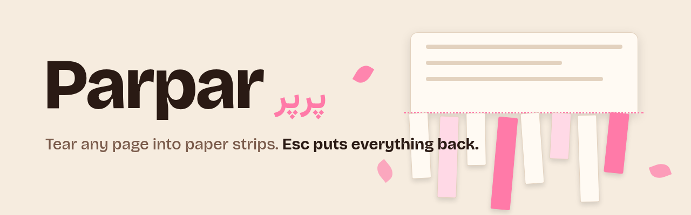

<div align="center" dir="rtl">

<picture>
  <source media="(prefers-color-scheme: dark)" srcset="assets/banner-dark.png">
  
</picture>

[English](README.md) · **فارسی** · [🌸 نمونهٔ زنده](https://mrzroot.github.io/gosast/)

[](LICENSE)
[](src/manifest.json)
[](#-حریم-خصوصی)
[](#-حریم-خصوصی)

</div>

<div dir="rtl">

**گسست** (Gosast، یعنی «از هم جدا شدنِ تمیز») یک اسباب‌بازی کوچک و آرام برای مرورگر است. دکمه را بزنید؛ صفحه‌ای که جلوی شماست تبدیل می‌شود به یک ورق کاغذ روی میز. می‌توانید آن را نوار‌نوار کنید، کاغذپاره بپاشید، تکه‌ها را با جارو کنار بزنید، چسب بزنید و برگردانید، یا کل ورق را بدهید به کاغذخردکن. با **Esc** صفحهٔ واقعی دقیقاً همان‌طور که بود برمی‌گردد. 🌸

برای یک دقیقهٔ آرام ساخته شده، نه برای عصبانیت: صدای ملایم کاغذ (به‌طور پیش‌فرض خاموش)، **حالت آرام** که تکه‌ها به‌جای افتادن محو می‌شوند، و برگشتِ همه‌چیز.

## ✨ چه کارهایی می‌شود کرد

| کلید | ابزار | کار |
| --- | --- | --- |
| `1` | ✂️ **نوار** | روی صفحه بکشید تا نوارهای کاغذ جدا شوند و بیفتند و کپه شوند |
| `2` | 🎉 **کاغذپاره** | کلیک یا کشیدن، مربع‌های ریز جدا می‌کند |
| `3` | 🧹 **جارو** | تکه‌های افتاده را کنار می‌زند |
| `4` | 🧴 **چسب** | تکه‌های زیر چسب پرواز می‌کنند و به جای اولشان برمی‌گردند |
| `S` | 🗑️ **همه را خرد کن** | یک تیغه از بالا می‌آید و همه‌چیز را خرد می‌کند |
| `R` | ⏪ **برگردان** | همهٔ تکه‌ها برمی‌گردند، از بالا شروع می‌شود |
| `G` | 🍃 **آرام** | تکه‌ها شناور می‌شوند و محو می‌شوند (اگر سیستم «کاهش حرکت» را خواسته باشد خودکار روشن است) |
| `M` | 🔈 **صدا** | صدای ساختگیِ کاغذ، پیش‌فرض خاموش |
| `L` | 🌐 **زبان** | جابه‌جایی نوار ابزار بین فارسی و English |
| `Esc` | 🌷 **سر جایش بگذار** | گسست بسته می‌شود و صفحه دست‌نخورده است |

همه‌چیز با صفحه‌کلید هم کار می‌کند: کلیدهای جهت‌نما یک نشانگر مجازی را حرکت می‌دهند (با `Shift` گام بزرگ‌تر)، و `Enter` یا `Space` فشار دادن و رها کردن است. رابط به **فارسی و انگلیسی** است (راست‌به‌چپ هم درست کار می‌کند) و زبان مرورگرتان را دنبال می‌کند.

## 🔒 حریم خصوصی

- **بدون شبکه.** گسست اصلاً درخواست نمی‌فرستد. سرور، آمارگیر و حساب کاربری ندارد.
- **بدون جمع‌آوری داده.** هیچ چیزی دربارهٔ صفحه ذخیره، ثبت یا ارسال نمی‌شود. عکسِ صفحه تا وقتی گسست باز است فقط در حافظه می‌ماند.
- **دسترسی‌های کم.** فقط `activeTab` و `scripting`، بدون دسترسی به هیچ سایتی. گسست فقط بعد از اینکه شما دکمه یا میانبرش را بزنید، و فقط روی همان تب اجرا می‌شود.
- **برگشت‌پذیر.** گسست صفحهٔ شما را ویرایش نمی‌کند (پایین‌تر را ببینید).

## 🧵 چطور کار می‌کند

1. دکمهٔ نوار ابزار را می‌زنید (یا `Alt+Shift+K`). مرورگر فقط برای همان تب `activeTab` می‌دهد.
2. اسکریپت پس‌زمینه از **بخش دیدنیِ صفحه عکس می‌گیرد** و بعد چهار اسکریپت کوچک را داخل تب می‌گذارد.
3. اسکریپت‌ها آن عکس را روی یک `<canvas>` داخل یک **لایهٔ Shadow DOM بسته** می‌کشند که کل پنجره را می‌پوشاند. تمام پاره کردن‌ها روی عکس انجام می‌شود: عکس به خانه‌های ۱۴ پیکسلی تقسیم می‌شود، نوار یعنی ردیفی از خانه‌ها، و یک فیزیک ساده باعث افتادن، کپه شدن و برگشتن تکه‌ها می‌شود.
4. صفحهٔ واقعی شما **هرگز تغییر نمی‌کند**. تنها تغییرِ DOM یک عنصر لایه است که اول اضافه و هنگام خروج حذف می‌شود. فرم‌ها مقدار، فوکوس و جای اسکرولشان را نگه می‌دارند؛ تا وقتی لایه باز است کلیدها به صفحه نمی‌رسند و چیزی داخل فیلدها تایپ نمی‌شود.

چون با عکس کار می‌کند، روی هر صفحه‌ای یک‌جور کار می‌کند، با هر CSP و فریم‌ورک.

## 📦 نصب از روی سورس

نود ۱۸ به بالا فقط برای ساختن فایل zip لازم است؛ خود افزونه هیچ وابستگی‌ای ندارد.

```bash
git clone https://github.com/mrzroot/gosast.git
cd gosast
npm test            # ۳۴ آزمون واحد
npm run build       # dist/chrome و dist/firefox و دو فایل zip را می‌سازد
```

**کروم / اج / بریو**
۱. `chrome://extensions` را باز کنید (در اج `edge://extensions`) و **Developer mode** را روشن کنید.
۲. **Load unpacked** را بزنید و پوشهٔ `dist/chrome` را انتخاب کنید.
۳. دکمهٔ 🌸 را سنجاق کنید، یک صفحهٔ وب باز کنید و روی آن بزنید. یا `Alt+Shift+K`.

**فایرفاکس ۱۴۲ به بالا**
۱. `about:debugging#/runtime/this-firefox` را باز کنید و **Load Temporary Add-on…** را بزنید.
۲. فایل `dist/firefox/manifest.json` را انتخاب کنید.
۳. افزونهٔ موقت با بسته شدن فایرفاکس می‌رود. برای نصب دائمی باید نسخهٔ امضاشده از فروشگاه افزونه‌ها باشد (هنوز منتشر نشده).

فایل‌های zip (`gosast-0.1.1-chrome.zip` و `gosast-0.1.1-firefox.zip`) به هر [انتشار گیت‌هاب](https://github.com/mrzroot/gosast/releases) پیوست‌اند.

## 🧪 آزمون‌ها

- `npm test` آزمون‌های خوانا برای هندسه و فیزیک (`tests/core.test.js`) و متن‌های فارسی/انگلیسی (`tests/strings.test.js`) را اجرا می‌کند؛ هر آزمون یک توضیح یک‌خطی دارد.
- `npm run e2e` افزونهٔ ساخته‌شده را در کروم واقعی (روی نمایشگر مجازی) بار می‌کند و روی یک صفحهٔ ساده، یک صفحهٔ فرم، یک صفحهٔ فارسی راست‌به‌چپ، یک صفحه با «کاهش حرکت» و یک مقالهٔ زندهٔ ویکی‌پدیا اجرا می‌کند. بررسی می‌کند HTML، مقدار فرم‌ها، فوکوس، اسکرول و پیکسل‌های صفحه بعد از خروج عیناً یکی باشند، صفحه دقیقاً دو تغییر DOM ببیند (افزودن و حذف لایه)، و در حالت باز هیچ خطای کنسول یا درخواست شبکه‌ای نباشد. عکس‌ها در `e2e/out/` ذخیره می‌شوند.

## 🚧 محدودیت‌ها

- فقط **عکسِ بخش دیدنی** صفحه را پاره می‌کند، نه کل سند. تا وقتی گسست باز است صفحه اسکرول نمی‌شود.
- تغییر اندازهٔ پنجره گسست را می‌بندد (چون عکس دیگر جا نمی‌شود).
- روی صفحه‌های خود مرورگر (`chrome://`، فروشگاه افزونه‌ها، `about:`) و PDFهای نمایشگر داخلی کار نمی‌کند.
- ویدیو و انیمیشن در لحظهٔ عکس ثابت می‌شوند.
- روی صفحه‌های خیلی بزرگ با هزاران تکه ممکن است در کامپیوترهای قدیمی کند شود؛ تعداد تکه‌ها حداکثر ۵۰۰۰ است.
- نسخهٔ فایرفاکس با `web-ext lint` بررسی شده و همان کد در کروم اجرا شده؛ هنوز در فایرفاکس واقعی آزمایش نشده است.

## 🗺️ نقشهٔ راه

- [ ] ثبت در فروشگاه کروم، افزونه‌های اج و افزونه‌های فایرفاکس
- [ ] اول اسکرول کردن، بعد پاره کردن بخش دیگر
- [ ] حالت «کل صفحه» با چسباندن چند عکس
- [ ] ابزارهای بیشتر: خط قیچی، چسب نواری، وزش باد
- [ ] ذخیرهٔ تصویر صفحهٔ پاره‌شده به‌صورت PNG
- [ ] زبان‌های بیشتر (ترجمه‌ها خوش‌آمدند، `src/strings.js` را ببینید)

## 📄 مجوز

[MIT](LICENSE) © ۲۰۲۶ محمدرضا زارع ([@mrzroot](https://github.com/mrzroot)). گسست یک اثر اصیل است. برای ارجاع در پژوهش یا وبلاگ، [CITATION.cff](CITATION.cff) آماده است.

</div>
